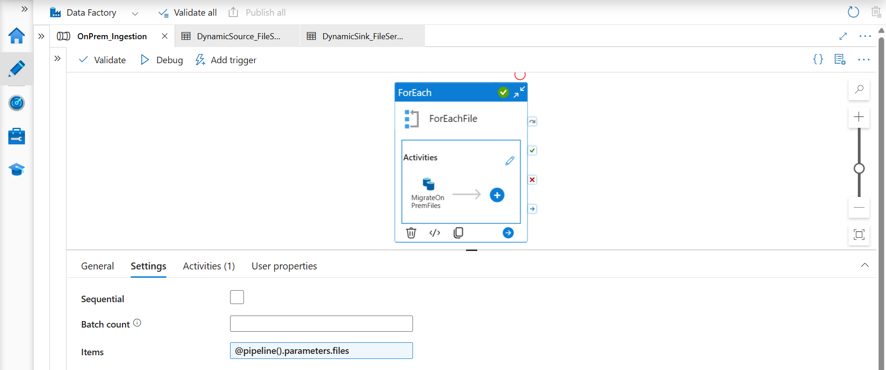
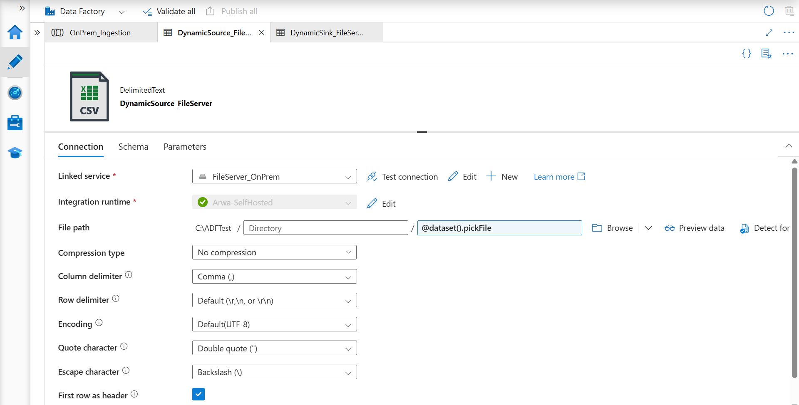
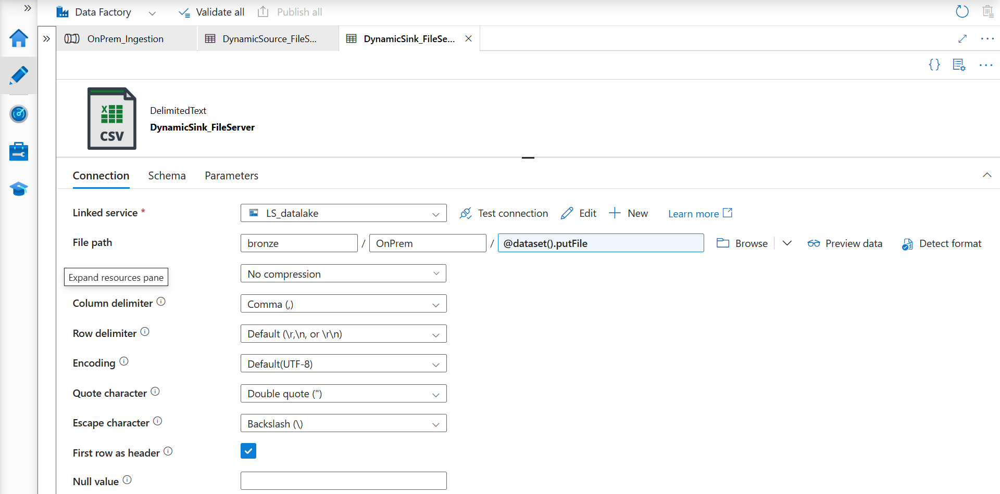
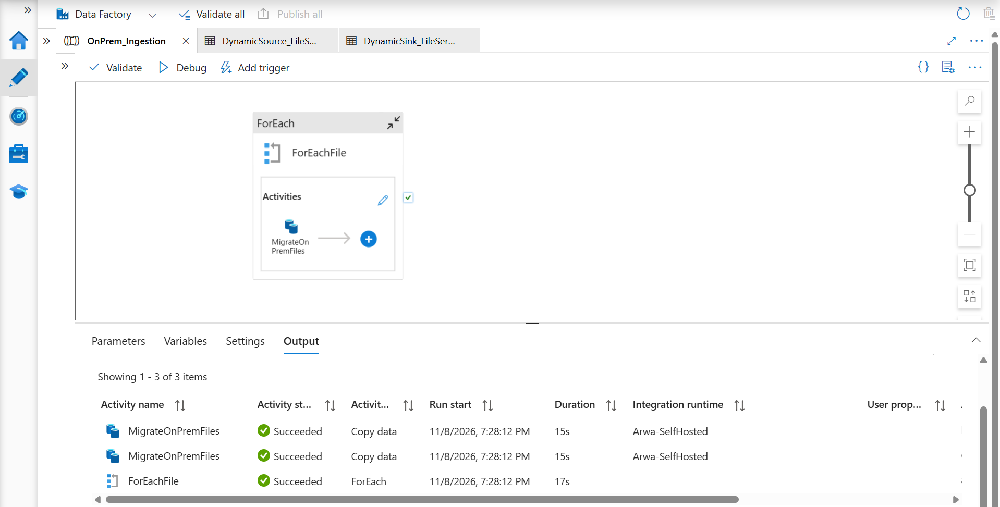
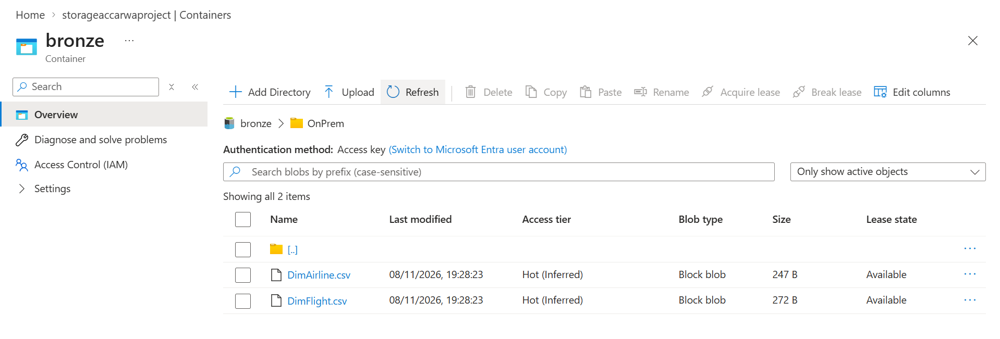

# ADF: Copy Files from a Local Drive to Azure Data Lake (Dynamic, Parameterized)

An Azure Data Factory (ADF) pipeline that copies CSV files from a **local C: drive folder** into **Azure Data Lake Storage Gen2**. The list of files comes from a **pipeline parameter (array)**, and a **ForEach** loop copies each file using **dynamic dataset parameters**. To add another file, you just add its name to the array. No pipeline changes needed.

## The idea in plain words

ADF lives in the cloud, so it can't see files on your own computer. To bridge that gap, you install a small program called a **Self-hosted Integration Runtime** on your machine. Think of it as a courier who lives inside your house: ADF tells the courier which files to fetch, and the courier carries them from your C: drive up to the cloud.

## What it does

1. The pipeline has a parameter `files`, an array of file names.
2. **ForEach** loops through that array.
3. For each file, **Copy Data** reads it from `C:\ADFTest` (through the self-hosted integration runtime) and writes it to the `bronze/OnPrem` folder in Data Lake Storage Gen2, keeping the same file name.

```
Pipeline parameter: files
        │
        ▼
     ForEach  (@pipeline().parameters.files)
        │
        ▼
   Copy Data  (MigrateOnPremFiles)
   C:\ADFTest\<file>  ──►  bronze/OnPrem/<file>
```

## Pipeline parameter

`files` (type: Array). Default value:

```json
[
  { "file_name": "DimAirline.csv" },
  { "file_name": "DimFlight.csv" }
]
```

## How the dynamic part works

| Where | Setting | Value |
|---|---|---|
| ForEach → Settings → Items | Items | `@pipeline().parameters.files` |
| Copy Data → Source dataset | `pickFile` parameter | `@item().file_name` |
| Copy Data → Sink dataset | `putFile` parameter | `@item().file_name` |
| Source dataset file path | File name | `@dataset().pickFile` |
| Sink dataset file path | File name | `@dataset().putFile` |

On each loop iteration, `@item().file_name` holds the current file name (for example `DimAirline.csv`). It is passed into both datasets, so one Copy Data activity handles every file.

## Components

| Component | Details |
|---|---|
| Pipeline | `OnPrem_Ingestion` |
| Activities | `ForEachFile` (ForEach), `MigrateOnPremFiles` (Copy data, retry set to 2) |
| Source dataset | `DynamicSource_FileServer` (DelimitedText, linked service `FileServer_OnPrem`, folder `C:\ADFTest`) |
| Sink dataset | `DynamicSink_FileServer` (DelimitedText, linked service `LS_datalake`, path `bronze/OnPrem`) |
| Integration runtime | `Arwa-SelfHosted` (self-hosted, installed on my PC) |
| Source | File system (local C: drive) |
| Destination | Azure Data Lake Storage Gen2 |
| File format | CSV: comma delimiter, UTF-8, first row as header |





## Prerequisites

- An Azure subscription and a Data Factory
- A Data Lake Storage Gen2 account with a `bronze` container
- A Windows machine with a **Self-hosted Integration Runtime** installed and registered to your data factory (status shows green)
- A folder on that machine (here `C:\ADFTest`) containing the CSV files
- A Windows account that can read that folder, used when creating the File system linked service

## How to recreate it

1. Install and register the self-hosted integration runtime (ADF Studio → Manage → Integration runtimes → New → Self-hosted).
2. Create a **File system** linked service that uses the self-hosted integration runtime, and an **ADLS Gen2** linked service for the destination.
3. Create the source dataset (DelimitedText on File system). Add a parameter `pickFile` and set the file name to `@dataset().pickFile`.
4. Create the sink dataset (DelimitedText on ADLS Gen2). Add a parameter `putFile` and set the file name to `@dataset().putFile`.
5. Create the pipeline and add an Array parameter `files`.
6. Add a **ForEach** with Items `@pipeline().parameters.files`.
7. Inside it, add **Copy data**. Set the dataset parameters `pickFile` and `putFile` to `@item().file_name`.
8. Click **Publish all**, then **Debug**. Check the **Output** tab for each file's copy.

To copy more files, add them to the `files` array when you run or trigger the pipeline.

## Result

After a successful run, each file listed in `files` appears in `bronze/OnPrem` in the data lake, with the same name as in the source folder.




## Project files

```
pipeline/
└── OnPrem_Ingestion.json
datasets/
├── DynamicSource_FileServer.json
└── DynamicSink_FileServer.json
images/
```

Exported from ADF Studio using the **{ }** code view.

> **Security note:** linked service files are intentionally not included, because they can contain credentials. Create your own linked services with your own account details.
